# GD2-10 — Single-view Metric Geometry: triển khai thực tế

> **Phạm vi:** phiên 10 (10.01–10.07; mở rộng UI 10.08.1–10.08.2).
> **Thời điểm khóa nội dung:** 2026-10-31 (UTC+07).
> **Code baseline đối chiếu:** `feat/gd2-10-metric-geometry@292c9d81404a75caccae21f3a3e08ec4fa8e2267`.
> **Trạng thái:** `IMPLEMENTED / SESSION_CLOSED_ACCEPTED_WITH_LIMITATIONS`.
> **Hồ sơ nghiệm thu:** [GD2-10 closure](../07-nghiem-thu/GD2_10_20261031_SESSION_CLOSURE.md).
> **Chú ý:** tên "Metric Geometry" chỉ nói đến tọa độ tính bằng mét theo calibration của Capture; **không** chứng nhận độ chính xác vật lý.

## 1. Mục tiêu và kết quả

Từ đúng **một** RAW RGB-D v2 của Orbbec Gemini 2, phần mềm có thể xác thực/đọc Replay, giải mã hai lưới ảnh RGB và Depth độc lập, sinh XYZ theo hệ quang học Depth, ánh xạ RGB theo ngoại chuẩn Depth-to-Color, trình bày point cloud có màu trong Viewer VTK hiện hữu, và đo khoảng cách Euclid giữa hai điểm do người dùng chọn. Không yêu cầu cắm camera khi Replay.

- `10.01`: kiểm tra intrinsics, depth scale, extrinsics và distortion theo đúng Capture.
- `10.02`: Depth Y16 → XYZ `float64`, quy đổi độ sâu sang `m`.
- `10.03`: validity mask, loại depth zero/out-of-range, loại tọa độ không hữu hạn.
- `10.04`: ánh xạ màu bằng color intrinsics, biến đổi Depth-to-Color, visibility/occlusion; không dùng ánh xạ pixel 1:1 giữa hai độ phân giải.
- `10.05`: `SingleViewXYZRGB`, điểm XYZ và RGB subset, thông tin lineage/quality.
- `10.B` corrective: Depth K6-zero và Color K6 của Gemini 2 thực tế; unit regression và H6 hai Capture PASS.
- `10.06`: chọn hai điểm, kiểm tra cùng Capture/cloud revision/frame, đo m và mm với cảnh báo chưa kiểm định.
- `10.07`: điều phối RAW Replay → Decode → Geometry, kiểm thử tích hợp synthetic và H6 read-only, full regression.
- `10.08.1`: Preview RGB point cloud từ Capture trong Desktop, góc camera `depth_optical` và auto-fit; VTK subprocess vẫn cô lập.
- `10.08.2`: chọn điểm A/B, overlay neo và đường nối, kết quả m/mm, kiểm tra Scene SHA/Revision, ánh xạ điểm RGB subset về XYZ gốc.

**Không thực hiện trong phiên 10:** segmentation, ROI-based object extraction, point cloud filtering, normals, multi-view registration/fusion, mesh reconstruction, bản xuất artifact chuẩn và `ProcessingRun`, điều khiển robot, xác nhận sai số bằng mẫu chuẩn.

## 2. Dòng xử lý và ranh giới trách nhiệm

```mermaid
flowchart LR
    A[CaptureContext / RAW v2] --> B[RawReplayService]
    B --> C[RgbdDecoder]
    C --> D[ReplayGeometryService]
    D --> E[GeometryService]
    E --> F[SingleViewXYZRGB]
    F --> G[Preview PLY tạm]
    G --> H[Viewer VTK subprocess]
    H --> I[Pick PLY ID]
    I --> J[RGB index -> XYZ index]
    J --> K[Measurement 10.06]
```

**Integrity boundary:** `RawReaderAdapter`/RAW reader chịu trách nhiệm xác thực manifest và SHA-256; hash truyền xuống `GeometryService` là thông tin provenance, không tự chứng minh integrity. Desktop Preview đọc **bản snapshot SQLite/RAW tạm** để hạn chế ghi vào kho H6 nguồn. Hiển thị và đo không sửa RAW.

**Geometry boundary:** kết quả `ValidGeometry.points_xyz_m` là `float64` trong `depth_optical` (`+X` phải ảnh Depth, `+Y` xuống, `+Z` hướng nhìn của cảm biến); `depth_scale_m_per_unit=0.001` trên hai Capture H6. D2C translation SDK được đổi từ mm sang m. `color_valid` và `colored_point_indices` mô tả subset có màu; điểm XYZ thiếu RGB không được tô giả.

**Viewer boundary:** Preview PLY là tệp **tạm**, không phải exported certified artifact. Vì PLY chứa `float32` XYZ và chỉ M điểm có màu, ID của PLY **không** đồng nhất chỉ số của N điểm XYZ. Với điểm được pick `ply_id`, dùng `colored_point_indices[ply_id] → XYZ float64`. Giới hạn SHA-256 scene, revision, Capture ID, coordinates/lineage phải khớp trước khi đo. PLY/OBJ ngoài Viewer vẫn giữ `units/frame=unknown` nếu không có provenance đã kiểm chứng.

**Measurement boundary:** chỉ là khoảng cách giữa hai điểm được chọn trên một single-view cloud, **không phải kích thước dài/rộng/cao toàn vật**. Status giao diện và dữ liệu: `PROVISIONAL_NOT_METRIC_VALIDATED`. Đổi Capture, đổi scene hoặc chiếu camera khác không được để lại cặp neo màn hình cũ.

## 3. Source map tại baseline

| Thành phần | Đường dẫn |
|---|---|
| Kiểm tra calibration | `src/scantopath/modules/geometry/application/calibration.py` |
| Unprojection | `src/scantopath/modules/geometry/application/unprojection.py` |
| Valid geometry | `src/scantopath/modules/geometry/application/validity.py` |
| Color mapping | `src/scantopath/modules/geometry/application/color_projection.py` |
| Single-view geometry | `src/scantopath/modules/geometry/application/service.py` |
| Provisional measurement | `src/scantopath/modules/geometry/application/measurements.py` |
| Replay → geometry orchestration | `src/scantopath/modules/geometry/application/replay_geometry.py` |
| Capture → UI Preview, scratch PLY | `src/scantopath/ui/shell/geometry_preview.py` |
| Chọn A/B và phép đo | `src/scantopath/ui/shell/geometry_measurement.py` |
| Picking/scene event | `src/scantopath/modules/viewer3d/presentation/interactive_controller.py` |
| Live mouse UI, anchor overlay | `src/scantopath/modules/viewer3d/presentation/live_view.py` |
| Camera/navigation | `src/scantopath/modules/viewer3d/application/navigation.py` và `infrastructure/camera_scene.py` |
| UI shell | `src/scantopath/ui/shell/main_window.py` |

Các test chính: `tests/unit/geometry/test_gd2_10_*.py`, `tests/integration/test_gd2_10_07_2_offline.py`. Architecture gate: `scripts/check_architecture_boundaries.py`; static quality gate: `scripts/check_07_12_quality.py` (đọc source theo UTF-8 trên Windows).

## 4. Kiểm thử dữ liệu thật (H6)

Bộ dữ liệu operator: `REAL_CAPTURE_20261030_231347` với `C0001` và `C0002`; tên/kho đường dẫn là minh chứng **môi trường operator**, không có RAW được đưa vào Git.

| Chỉ tiêu | C0001 | C0002 |
|---|---:|---:|
| Capture ID | `0d23c9da9059488fa5fe34a3e9af8c07` | `7369033a75c445749579cc9e4f2f4bf8` |
| Depth/model, Color/model | 4 K6-zero / 4 K6 | 4 K6-zero / 4 K6 |
| Depth pixels | 1,024,000 | 1,024,000 |
| XYZ hợp lệ | 624,520 | 626,748 |
| Điểm RGB Preview | 469,997 | 473,228 |
| RGB/XYZ | 75.26% | 75.51% |
| Timestamp delta (SDK reported) | 5,149 µs | 5,146 µs |
| H6 total pipeline (quan sát, một lượt) | 938.71 ms | 232.93 ms |
| H6 measurement (quan sát, một lượt) | 24.43 ms | 24.41 ms |
| RAW/SQLite checksum trước và sau | PASS | PASS |

Các số thời gian là **quan sát**, không phải benchmark bảo đảm hoặc cổng hiệu năng chuẩn. Capture C0001/C0002 không chứng minh multi-view, calibration bằng vật chuẩn hay synchronization vật lý.

## 5. Hướng dẫn thao tác Desktop (đã thử thủ công)

1. Chạy `python -X utf8 -m scantopath.ui.main` trong môi trường `.venv`, với `QT_QPA_PLATFORM` **không** đặt `offscreen` khi thử UI thật.
2. Mở Project Store chứa hai RAW H6; vào **Thu nhận RGB-D → RAW đã lưu / Phát lại**, chọn C0001 hoặc C0002.
3. Chọn **Xem XYZRGB 3D**. Viewer hiển thị PLY RGB tạm; camera nhìn theo Depth +Z / up −Y; auto-fit được áp dụng, grid mặc định tắt.
4. Bấm **Đo 2 điểm**, nhấp ngắn A rồi B trên vùng có điểm hiển thị. Neo A (vàng), B (xanh ngọc), đường nối và khoảng cách `m` / `mm` xuất hiện. Nhấp và giữ/kéo không tương đương thao tác chọn điểm.
5. Dùng **Xóa phép đo** để chọn cặp khác. Khi đổi Capture, đổi scene hoặc góc nhìn khiến overlay không còn đúng, neo cũ phải bị hủy và cần chọn lại.

**Không** coi phép đo giữa hai điểm tuỳ ý trên scene chứa nền là chiều cao/chiều rộng vật. Trong GD2-11 mới bổ sung tách vật thể và lọc nhiễu.

## 6. Hướng phát triển GD2-11

Bắt đầu từ `SingleViewXYZRGB` hiện có; giữ **scene cloud** để phục vụ thông tin môi trường và tạo **object cloud** bằng ROI/segmentation có provenance riêng. Không làm biến đổi RAW gốc, không gán `metric_validated=True`, không nhập giả chức năng normals/mesh/ProcessingRun từ các phiên sau. Đối chiếu [kế hoạch GĐ2](GD2_RAW_REPLAY_SINGLE_VIEW_GEOMETRY.md) và [hồ sơ đóng 10](../07-nghiem-thu/GD2_10_20261031_SESSION_CLOSURE.md).
