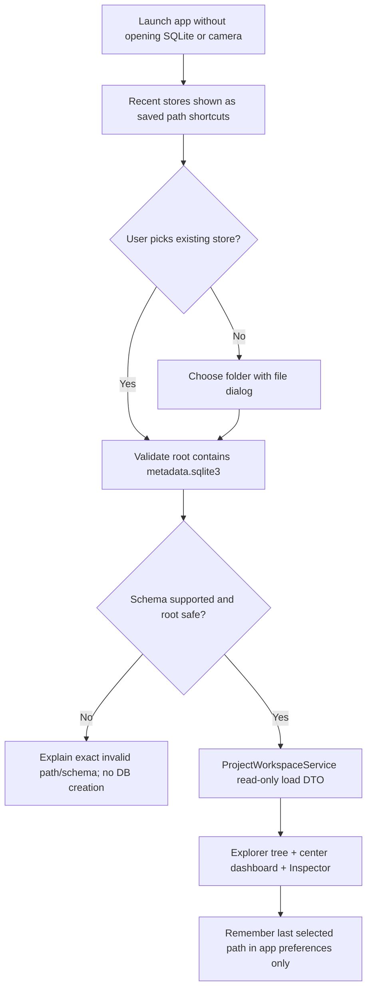
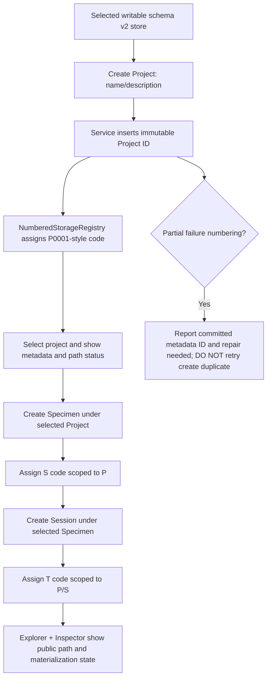
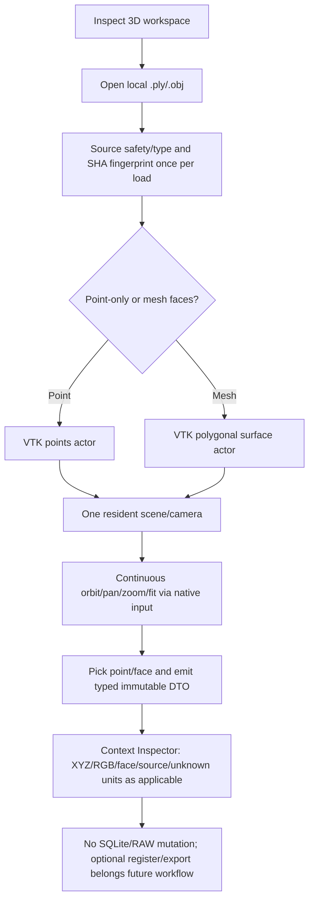
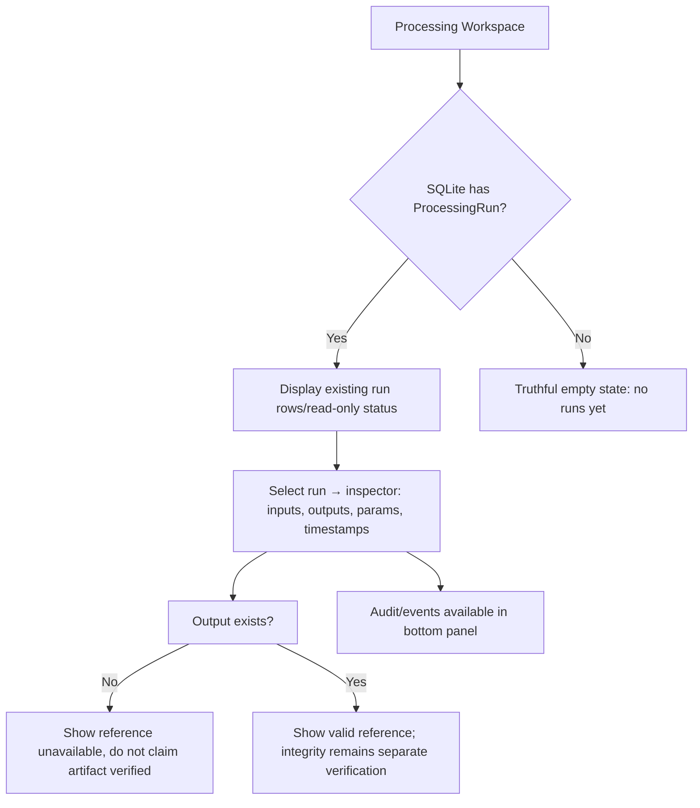

# R1.2 — UX Information Architecture & Workflow Blueprint

**Status:** R1 proposed design contract for implementation via R2/R3/R5; no Qt widgets changed by this document. **Purpose:** make ScanToPath a tool for Project → Acquisition → 3D Inspection → Processing, not a welcome-card navigation shell.

## Governing UX principles

1. **Workspace owns the job; dock offers context tools; Inspector describes the selection.** Never create a central workspace whose sole action is to open a dock already visible.
2. **One authoritative data source per truth:** SQLite for Project/Run relationships, NumberedStorageRegistry for public codes/paths, PLY/OBJ reader for geometry, native task state for running work. Context stores view selection only, not measurement facts.
3. **One physical selection, one contextual Inspector:** project/specimen/session/capture/processing run/point/face each show distinct fields; unknown units/frame/pose displayed as unknown, never fabricated.
4. **3D canvas first:** maximize useful viewport area; commands are icon overlay/menus with accessible labels and keyboard shortcuts; errors compact and actionable.
5. **Progressive disclosure:** empty-state only when empty; warnings/errors inline; detailed logs in collapsed task area; advanced/dev tools behind explicit menu.
6. **Offline first:** no auto camera, auto migration, empty SQLite creation, or RAW write during app startup. Store root selection is explicit; remembering last location is not permission to open/write it.

## Primary screen structure (recommended single design, not three competing styles)

```text
┌─ Menu · Command palette (Ctrl+Shift+P) ────────────────────────────────────────────┐
│ ScanToPath | [Dự án] [Thu nhận] [Kiểm tra 3D] [Xử lý] | Project: P0001 ▾  [⋯]   │  ~38 logical px
├────────────────┬───────────────────────────────────────────┬──────────────────┤
│ EXPLORER       │ WORKSPACE FRAME (border + radius 8px)    │ INSPECTOR        │
│ scoped source  │ [breadcrumb]          [tools/actions]      │ selected object   │
│                │ ┌───────────────────────────────────────┐ │                  │
│ P0001          │ │ 3D CANVAS (or Projects/Run work area) │ │ Name, ID, source │
│   S0001        │ │ ┌────┐                                │ │ XYZ / RGB /      │
│     T0001      │ │ │icons│                               │ │ units / frame    │
│        C0001   │ │ └────┘                                │ │ reliability      │
│                │ │                                       │ │                  │
│ Scene layers   │ │                                       │ │ context actions  │
│ (when 3D)      │ │ [source · count · units · status]      │ │                  │
│                │ └───────────────────────────────────────┘ │                  │
├────────────────┴───────────────────────────────────────────┴──────────────────┤
│ [Tasks] [Problems] [Events] ▴ collapse | height content-driven; no demo controls │
├────────────────────────────────────────────────────────────────────────────────┤
│ Status: Ready | Store: GD1_07_5_TEST | Frame: unknown | Units: unknown          │
└────────────────────────────────────────────────────────────────────────────────┘
```

**Visibility policy:** Explorer normally shown in Projects, optional in Viewer for Scene; Inspector shown only if useful, otherwise auto-collapsed on constrained widths; bottom panel normally collapsed to compact header (24–28 logical px), expanded for jobs/errors; preserve manual dock choice unless Reset Layout explicitly invoked. Command availability must not depend on whether a dock is currently visible.

### Geometry and responsive layout contracts (targets to test, not yet measured)

| Area | Normal desktop (logical 1366×768) | Narrow/hi-DPI window |
|---|---|---|
| Workspace navigation | one 36–40px strip, text; no horizontal clipping | reduce padding; then overflow menu; preserve text in tooltip/accessibility |
| Explorer | 220–280px resizable | collapsible/tab; min width never forces central into zero |
| Inspector | 240–300px resizable | can collapse into right icon rail with keyboard access |
| Bottom tasks | collapsed 24–28px; expanded on progress/error | overlay/float allowed; no mandatory 160px empty bar |
| Workspace boundary | clear QFrame outline ~1px, radius 6–8px, no nested duplicate strokes | one boundary per functional region |
| 3D viewport | strive ≥70% **center work region** height with no Inspector text rows below | central canvas gets priority; controls within canvas overlays |
| Icon tools | 32–38px target with SVG/theme icons, tooltip + accessibleName | keyboard alternative, no icon-only unlabelled command |
| Status | single-line status + expandable Problems | no long descriptions clamping width |

Test real Windows 100%,125%,150% scaling, at least laptop-sized logical areas plus narrowed splitters. Do not hard-code title/string height to a particular font; use Qt size hints and elision/overflow.

## Responsibilities of the four real workspaces

| Workspace center (owns task) | Explorer left (structure) | Inspector right (facts/actions) | Bottom panel (async history) |
|---|---|---|---|
| **Dự án**: project dashboard, current store identity, selected project details, specimen/session/capture table, search/filter, empty state, create action | P/S/T/C/R tree and recent-store entry; no duplicate big Open Store card | selected project/specimen/session/capture metadata, storage code, status, verified path, close/edit/check RAW | background load errors; SQLite audit is a separate Events filter |
| **Thu nhận RGB-D**: GĐ1 honest compact reserved page; session 09 Replay left/right frames, timestamps and selected capture | capture/session source hierarchy | frame size/intrinsics/RAW provenance after 09 | decode/replay jobs/errors |
| **Kiểm tra 3D**: **actual renderer**, point cloud/mesh scene and viewport, camera toolbar floating vertically | Scene hierarchy (objects/layers/visibility; Project tree via scope toggle) | selected point/face/scene source with XYZ, RGB, bounds, units/frame, provenance | load/render progress and errors, hidden when idle |
| **Xử lý**: actual `ProcessingRun` list (read-only now), state, stage, input/output links, error summary; algorithms only in later sessions | session → processing run tree | run metadata/parameters/artifact references with existence/integrity distinction | running tasks, progress, job logs; SQLite audit remains traceability tab, not entire workspace |

**Important:** R2 makes generic shell, R3 fills currently feasible Project/Processing read-only center; R5 fills real 3D. Capture interactive replay remains 09. No fabricated processing results.

## End-to-end workflows, including explicit errors and boundaries

### F01 — Open/reopen a data store



No auto-open by default: QSettings stores bookmarks and last selected path; only opens on explicit user action. Existing profile/bookmarks outside SQLite and RAW; missing/moved folder shown with repair path, no hidden creation. A later explicit **Create data store** wizard requires its own validated initialization contract, migration/rollback and tests; **do not conflate Create Project with Create Store**.

### F02 — Create Project, Specimen, Session (existing schema v2 store)



Code/relative path must come from resolver, not manually join user display labels; filesystem may remain `not_materialized`. No implicit migration v1 to v2. No automatic RAW. `Create Project` is a database entity operation **inside selected store**, not a new store directory.

### F03 — Inspect external geometry without modifying Project



External local file is **unattached** to Project until an explicit future import/registration use case. PLY points/mesh choice based on parsed geometry; OBJ supports mesh geometry and material/texture only if tested. Invalid file: error + no stale preview/metadata; preserve user workflow state.

### F04 — Processing status (current vs later)



Algorithm execution for ROI/filter/fusion **not** part of R3; actual pipeline workflows retain their sessions 10–16. Bottom panel shows tasks/errors/log, not a substitute for the Processing workspace.

## Detailed contextual Inspector schema

| Selected type | Primary fields | Optional actions | Prohibited assumptions |
|---|---|---|---|
| Store | name/path, schema version, active count, open mode | change/open in File Explorer | file path existing ≠ database valid |
| Project | public code, name, description, ID, updated, child counts, relative path, materialization | edit, add specimen | no fake scanned geometry |
| Specimen | label, source ID, parent Project, count sessions, relative path | edit, add session | no camera pose inferred |
| Session | state open/closed, parent, captures/runs, last timestamp | close (confirm), inspect captures | not automatically active capture |
| Capture | frame metadata/RAW path, hash/integrity when verified | verify RAW | RAW exists ≠ metric calibrated |
| Scene/Point | file format, geometry kind, points/faces/bounds, RGB if present, selected point XYZ; `units=unknown`, `frame=unknown` | fit, visibility, source info | no physical mm claim from arbitrary PLY |
| ProcessingRun | state, stage, algorithm, input refs, output refs, error, provenance | inspect artifact where valid | output ref ≠ materialized/verified output |

## Concrete focus and interaction rules

- Changing workspace retains selected store and underlying Project identity, but may clear incompatible visual selection; selection is scoped by type and version. Do not silently clear Project context just because Viewer is opened.
- Inspector selection has priority: explicit selected point/face → selected scene source → selected Project node. If selection becomes invalid, show a clear 'no selection' state without stale metadata.
- Toolbar commands: `Ctrl+O` open file **within current workspace** (Project: open store; 3D: open geometry), `F` fit model in 3D, `Esc` clear selection, `Ctrl+B` toggle Explorer, `Ctrl+J` bottom tasks; collisions with existing shortcuts require R2 inventory before binding.
- Red/error states are consistent and non-modal for recoverable failures; destructive create/close/migrate actions require confirmations appropriate to data risk.
- All busy actions expose progress/cancel where possible; disabled commands have reason tooltip, not simply blank/grey buttons.

## Non-negotiable UX acceptance

1. Project can be reopened from recent stores without typing filesystem paths; user can open a valid schema v2 store and create P/S/T via real service.
2. No central workspace merely repeats a global dock action; four workspace states distinguish working/empty/not implemented.
3. Nav labels, task tabs and tooltips remain readable on supported window/DPI combinations; keyboard available for icons.
4. Viewer controls consume no text rows below scene; point/mesh info moves to Inspector and/or compact status.
5. Scene input never marks unknown PLY units/frame or projected coordinates as validated metric data.
